  

<h1 align="center">Hi, I'm Emmanuel Ahiati 👋</h1>

  <b>BSc Information Technology @ University of Ghana · Data Engineer</b> 
  <i>I turn raw data into decisions and build tools that automate the boring stuff.</i>

  

---

### 📌 Key Projects

| Project | What it does | Stack |
| :--- | :--- | :--- |
| **[Coffee Shop Sales Analysis](https://github.com/great-tinz/Coffee-Shop-Sales-Analysis)** | End-to-end analysis of 149K+ sales rows — star schema, dashboard & staffing insights. | `Excel` `MySQL` |
| **[Grand Hotel Management System](https://github.com/great-tinz/grand-hotel-db-project)** | Normalized hotel database with ER modeling, integrity constraints & analytical SQL. | `MySQL` `DB Design` |
| **[Music Store SQL Analytics](https://github.com/great-tinz/music-store-sql-analytics)** | Business-question SQL on an 11-table database — joins, CTEs & recursive queries. | `SQL` `MySQL` |
| **[Oasis Infobyte Analytics Tasks](https://github.com/great-tinz/OIBSIP)** | Retail EDA, messy HR data cleaning & Google Play Store sentiment analysis. | `Python` `Pandas` |
| **[Online Course Platform DB](https://github.com/great-tinz/online-course-platform-db)** | E-learning database with 6 entities, ERD & 20+ analytical queries. | `MySQL` `ERD` |
| **[University Exam Records System](https://github.com/great-tinz/university-exam-db-project)** | Exam-records DB with many-to-many enrollment & strict data-integrity rules. | `MySQL` `SQL` |

<a href="https://github.com/great-tinz?tab=repositories">View all repositories →</a>

---

### 🔭 Currently Exploring

- 📊 Data Analytics & Data Engineering
- 💻 Software Development & Database Management
- 🔐 Cybersecurity & Networking
- ⚙️ Business Process Automation
- 🤝 Sales & Business Development

---

### 🛠️ Tech Stack & Tools

**📊 Data Analytics & Engineering**

**💻 Software Development**

**🔐 Cybersecurity & Networking**

**⚙️ Development & Automation Tools**

---

### 🐍 Contribution Graph

  

---

### 📫 Connect With Me

---

  <i>Learning • Building • Automating • Growing</i>

